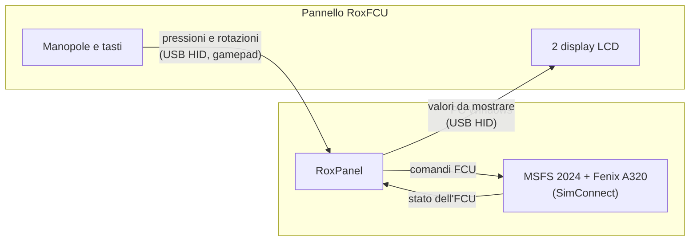

# RoxPanel

**RoxPanel** collega le periferiche fisiche di un cockpit al simulatore di volo. La prima periferica è **RoxFCU**: un pannello FCU (Flight Control Unit) per l'**Airbus A320 Fenix** in **Microsoft Flight Simulator 2024**, con manopole, tasti e due display, che si comporta come l'FCU vero.

Questa repo contiene **solo le release** (il programma per Windows e il file che permette all'app di sapere se c'è una versione più nuova). Il codice sorgente è privato.

➡️ **[Scarica l'ultima versione](../../releases/latest)**

---

## Cosa fa

Il pannello RoxFCU ha:

- **4 manopole** con encoder rotativo, per **velocità (SPD)**, **prua (HDG)**, **quota (ALT)** e **velocità verticale (V/S)**. Ogni manopola si ruota, si **preme** (push) e si **tira** (pull, pressione lunga), come sull'aereo.
- **6 pulsanti**: **AP1, AP2, ATHR, LOC, EXPED, APPR**.
- **2 display LCD 16×2** che mostrano gli stessi valori del pannello reale, in colonne:

```
 SPD         HDG        ALT      V/S
 250         090      ·05000    +15oo
```

Il display riproduce le convenzioni dell'FCU: quota a cinque cifre (5000 ft = `05000`), Mach (`.78`) al posto della velocità quando serve, trattini quando un valore è "dashed", il puntino accanto a velocità, prua e quota quando sono in modo *managed*, e la velocità verticale con gli ultimi due zeri più piccoli.

RoxPanel mostra anche in tempo reale lo **stato del sistema**: se il simulatore risponde, se la periferica è collegata, se c'è un aggiornamento.

## Come funziona



1. **Il pannello** è visto dal computer come un **gamepad USB** (un'unica interfaccia HID). Quando giri una manopola o premi un tasto, invia un report con lo stato di tutti i controlli.
2. **RoxPanel** legge quei report, riconosce i fronti (una rotazione, una pressione breve o lunga) e li traduce in **comandi per l'FCU del Fenix**, che invia direttamente al simulatore tramite **SimConnect**.
3. In senso inverso RoxPanel **legge dal simulatore i valori dell'FCU** (sempre via SimConnect) (velocità, prua, quota, velocità verticale e i relativi flag) e li manda al pannello, che li disegna sui display. Il pannello aggiorna solo ciò che cambia.
4. Il pannello e il programma si controllano a vicenda con un **segnale di vita** (heartbeat): se RoxPanel si ferma, il display mostra `ERROR: NO LINK`; se è il simulatore a non rispondere, mostra `SIMCONNECT OFF`.

### Perché un gamepad

Alcuni ambienti, come i PC cloud, inoltrano al PC remoto solo le periferiche USB con una singola interfaccia HID (come joystick e manette). Un dispositivo "composito" (tastiera + porta seriale + disco) non passa. RoxFCU è quindi progettato come un **unico dispositivo HID**, che funziona sia su un PC Windows locale sia su un PC Windows in cloud con inoltro USB.

### Modalità del pannello

- **Funzionamento normale**: gamepad HID, nessun disco o console esposti.
- **Manutenzione** (si attiva con un ponticello all'avvio): il pannello si presenta come disco USB per aggiornare il suo firmware, e non invia comandi.

## Requisiti

- **Windows** (provato su Windows 11), anche un PC cloud con inoltro delle periferiche USB.
- **Microsoft Flight Simulator 2024** con l'**Airbus A320 Fenix**.
- **SimConnect.dll** (la libreria di Microsoft per parlare con il simulatore): al primo avvio, se non è già sul PC, RoxPanel propone di scaricarla (vedi sotto). Non serve nessun altro programma.
- Il pannello **RoxFCU** collegato via USB.

## Installare e usare

1. Scarica `RoxPanel-X.Y.Z.zip` dalla sezione **Releases**.
2. Estrailo in una cartella a tua scelta (non serve installare Python).
3. Avvia `RoxPanel.exe`.
4. Se Windows mostra l'avviso *"Windows ha protetto il PC"* (SmartScreen): l'eseguibile non è ancora firmato digitalmente. Scegli **Ulteriori informazioni → Esegui comunque**. Puoi verificare lo zip con lo **SHA-256** indicato nelle note di ogni release.

La finestra di stato mostra una riga per ogni componente: **simulatore**, **SimConnect.dll**, lettura dei dati dell'**FCU**, **RoxFCU** collegato e **aggiornamenti**. Un cerchio **verde** significa che è tutto a posto, **giallo** un avviso, **rosso** un errore e **grigio** un controllo in attesa.

### Primo avvio senza SimConnect.dll

Se RoxPanel non trova `SimConnect.dll`, la finestra mostra solo un pulsante **"Scarica SimConnect.dll"**: il programma resta in attesa finché non la procuri. Dopo che hai confermato, RoxPanel la scarica da PyPI (dal pacchetto `SimConnect`, versione e impronta SHA-256 fissate nel programma, solo da `files.pythonhosted.org`) e la salva in `%LOCALAPPDATA%\RoxPanel\vendor`, poi si collega senza riavvio. Nulla viene scaricato senza il tuo consenso.

- La DLL è di Microsoft e **non è inclusa nello zip**: la licenza non chiarisce la ridistribuzione, quindi la scarichi tu. Il pacchetto `SimConnect` è sotto licenza AGPL-3.0: RoxPanel non lo usa né lo ridistribuisce, ne estrae solo quel file.
- In alternativa copia tu `SimConnect.dll` (64 bit, dall'SDK di MSFS) accanto a `RoxPanel.exe` o in una cartella `vendor`.
- Per rimuoverla basta cancellare `%LOCALAPPDATA%\RoxPanel\vendor\SimConnect.dll` a RoxPanel chiuso.
- La DLL del pacchetto nasce per MSFS 2020 ma funziona anche con MSFS 2024.

I log di funzionamento si trovano nella cartella `logs` accanto a `RoxPanel.exe`.

## Aggiornamenti

All'avvio RoxPanel legge il file [`latest.json`](latest.json) di questa repo per sapere qual è l'ultima versione pubblicata. Se ce n'è una più nuova, la riga **Aggiornamento** diventa gialla e ti dice quale. L'app **non scarica né installa nulla da sola**: l'aggiornamento si scarica a mano dalla sezione Releases. Se la rete non c'è, l'avvio prosegue normalmente.

## Cosa c'è in questa versione

- **0.2.0**: RoxPanel parla **direttamente con il simulatore tramite SimConnect**, senza più AAO. Download di `SimConnect.dll` al primo avvio (con consenso), con schermata dedicata. Il puntino *managed* ora c'è anche su velocità e prua (con la preselezione che mostra il valore e poi torna ai trattini, come l'FCU vero). Finestra di stato più compatta e ordinata, con i nomi RoxFCU. Riconnessione automatica se il simulatore si chiude e si riapre.
- **0.1.0**: prima versione pubblica. Finestra di stato, comunicazione con il pannello RoxFCU come gamepad HID, lettura e comando dell'FCU del Fenix A320 tramite AAO, display a colonne, avviso di nuove versioni.

## Prossimi passi

Idee in valutazione, nessuna promessa di tempi:

- **Aggiornamento automatico** dell'app dalla finestra di stato.
- **Altre periferiche** oltre all'FCU, con lo stesso approccio (un solo dispositivo HID per pannello).
- **Modo TRK/FPA** dell'FCU sui display.

## Limiti noti

- Funziona solo su **Windows** e solo con l'**A320 Fenix**.
- L'eseguibile **non è firmato**: Windows può mostrare un avviso alla prima apertura.
- Se gli stessi pulsanti sono assegnati anche in altri programmi (per esempio un software di mappatura), il comando può essere eseguito due volte.

## Informazioni sulla repo

| File | A cosa serve |
|---|---|
| `latest.json` | Versione più recente, indirizzo di download e hash SHA-256, letti dall'app |
| Releases | I pacchetti `RoxPanel-X.Y.Z.zip` |

## Licenza

Uso **non commerciale** consentito, **senza modifiche**. Ogni scopo commerciale è vietato e va concordato per iscritto scrivendo a **andrea@rossinisolutions.com**. Il testo completo è nel file [`LICENSE`](LICENSE).

Progetto personale di **Andrea Rossini**, **Rossini Solutions**. RoxPanel è un progetto indipendente e non è affiliato a Fenix Simulations, Microsoft o Asobo.
